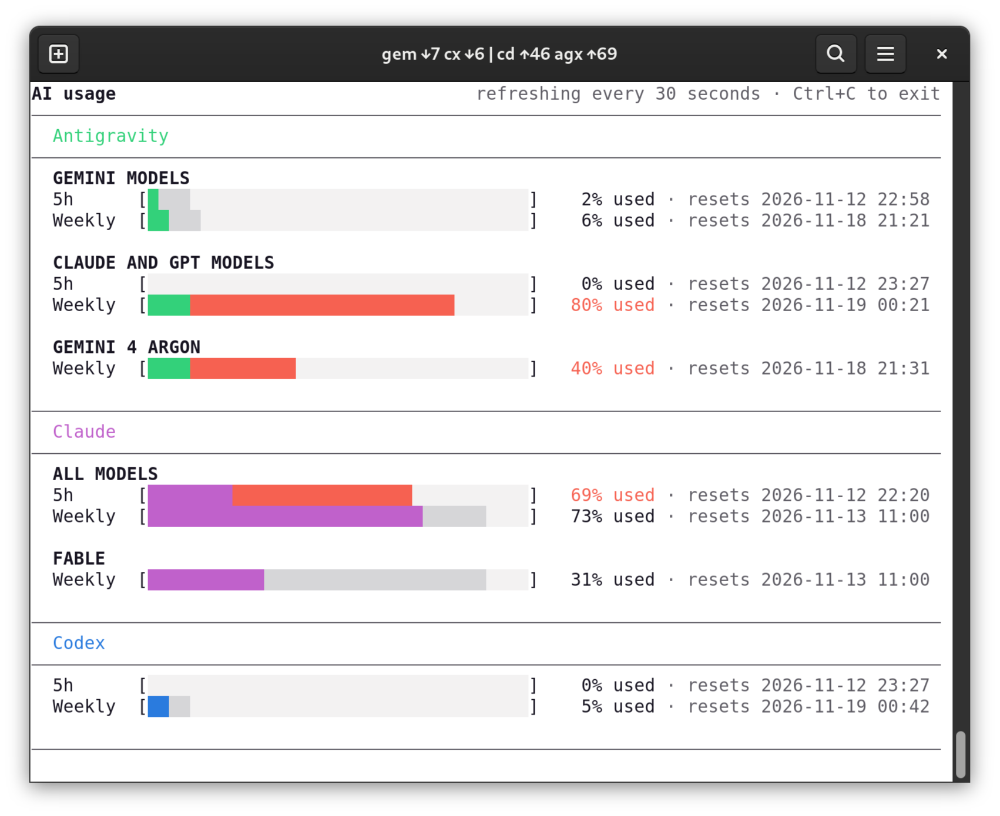

# personal-tools

## ai_usage.py

Terminal dashboard of the usage limits of Codex, Claude Code and Antigravity.
Requires Python 3.9+ and uses the standard library only; the data comes from
`codex app-server`, `claude -p /usage` and `agy -p /usage`, so all three CLIs
must be installed and logged in.



```bash
./ai_usage.py                 # refresh every 30 seconds
./ai_usage.py --once          # print once and exit
./ai_usage.py --only codex    # one provider: codex, claude or agy
./ai_usage.py --interval 60
```

Each bar shows the usage of a 5-hour or weekly window. The grey part is split
where the window currently is in time: the darker shade is time that has
already passed, the lighter shade is time left. Usage beyond that point, and
its percentage, is red: the limit is being used faster than time passes.
When a window is used up, its reset time appears in red next to the provider
name.

The terminal title summarises five agents (`gem`, `agx` and `arg` for the
Antigravity groups, `cd` for Claude, `cx` for Codex) by how far they are from
using the limit at the same pace as the window, in percentage points: the two
with the most headroom (`↓`, best first), then `|`, then the two furthest
ahead of schedule (`↑`, worst first), so the extremes sit next to the bar. An
agent whose window is used up shows its reset time instead.

The layout adapts to the terminal: the words `used` and `resets` disappear
when columns run out, the header and blank lines disappear when rows run out,
and the screen is redrawn on resize.

## prefix-cleanup

Interactively shorten allowed Codex prefixes to two elements (a command and one
argument), for example `git add abc` and `git add xyz` → `git add`.
Requires Python 3.9+ and uses the standard library only.

```bash
./prefix-cleanup /path/to/default.rules
```

The rules file path is required.

The tool displays one single-line prompt for each proposal, such as
`Prefix "git add ..."? [A]llow [p]rompt [d]eny [s]kip [v]iew [l]onger` (the
capital letter marks the default). Answer `a` (or Enter) to add the prefix with
`decision="allow"`, `p` for `decision="prompt"` (always ask), `d` for
`decision="forbidden"`, or `s` to skip it. `v` shows the rules that the prefix
would shorten, as shell commands, and asks again. `l` replaces the proposal
with longer prefixes (one more element each), for example `python3 -m ...` →
`python3 -m py_compile ...`; other answers repeat the question.
Prompt and deny rules do not make longer allow rules redundant, and prefixes
that already have a rule are not proposed again. Then `Add N rule(s)? [y/N]`
confirms adding the selected rules (Enter declines).
A separate prompt, `Remove N rule(s) covered by shorter prefixes? [y/N]`,
offers to remove rules covered by existing or newly added prefixes (Enter keeps
them). Batch prompts appear only when N > 0.

Shortening a rule grants permission for every argument sequence after the
selected prefix. Adding and removing rules require separate confirmations.
Comments are preserved; rules with extra attributes are skipped. Before saving,
the tool removes blank lines after confirmed rule cleanup and creates a `.bak-*`
copy beside the file before saving. Ctrl+C or end-of-input cancels the session
without saving.

Run tests with `python3 -m unittest discover -s tests -v`.
